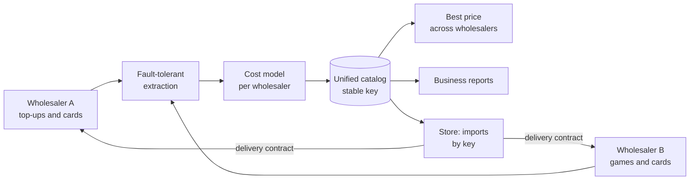

# Top-up catalog and pricing engine

> It unifies the catalogs of several wholesalers of mobile top-ups, gift cards
> and game credits into a single format. It works out the real cost of every
> product and the price worth selling it at, and records how to order the
> delivery of each one.

**Status:** in use: it is the tool used to map the wholesalers and set the
pricing model of [recargasdigitales.com](https://recargasdigitales.com) ·
**Proprietary system** by Kusarive Solutions LLC ·
[Versión en español](README.md) ·
[Presentation page](https://rjblancos.github.io/api-juegos-recargas-showcase/) ·
**[Download the presentation as PDF](presentacion/Motor-catalogo-recargas-presentacion.pdf)** (10 slides, in Spanish)

---

## The problem

Every wholesaler speaks its own language. One charges a discount on face value,
another a direct price, and another adds fixed fees that eat the margin on
small cards. Some issue in another currency. Each one asks for different data to
deliver: a phone number, a player ID, a server.

Comparing all that by hand is impossible across thousands of products. That is
why selling at face value without doing the math can quietly lose money.

This engine solves it before a product reaches the store. Every product comes
out with its real cost, a suggested price, whether it is profitable, what to ask
the customer for and how to order delivery.

## What it does

- **Maps each wholesaler's full catalog** through its API: mobile top-ups, gift
  cards, game top-ups and bill payments.
- **One format for all of them.** Every product, wherever it comes from, comes
  out with the same columns and a stable key that never changes between runs.
- **Real cost per denomination.** It applies each wholesaler's model: discount,
  fixed fee, percentage fee and issuing currency.
- **Sale price for the requested margin**, flagging products that lose money
  when sold at face value.
- **Picks the cheapest wholesaler** when two sell the same product.
- **Delivery contract per product.** Each row states what to ask the customer
  for and what to send the wholesaler to deliver.
- **Orders run in simulation by default.** No test spends balance: buying for
  real must be enabled explicitly.
- **Generated business reports.** What is worth selling by profit, a comparison
  between wholesalers and each one's catalog.
- **Images included.** Every product carries the image its wholesaler provides:
  none is uploaded by hand.

## Benefits

| | |
|---|---|
| **Never sell at a loss** | Products that lose at face value are flagged before they are published. |
| **Adding a wholesaler touches nothing else** | Each lives in its own module with the same shape: config, client, extraction, pricing and report. |
| **A store can simply import** | It receives a file with everything worked out and creates its products by the stable key. |
| **Price history** | Every run is dated, so cost changes can be tracked over time. |
| **Runs on any server** | It only needs the Python interpreter: zero dependencies, zero installation. |

## Architecture



If a wholesaler or a category fails, the failure is logged in a manifest and
shows up in the report, and the rest of the run carries on.

## Sample row from the unified catalog

Made-up data. The format is the real one:
[`ejemplos/fila-unificada.json`](ejemplos/fila-unificada.json).

```json
{
  "sku": "mayorista-b:juego:ejemplo_juego:paquete_100",
  "linea": "juego",
  "variante": "100 monedas",
  "costo_usd": 0.95,
  "precio_venta_sugerido": 1.1875,
  "margen_pct": 20,
  "vendible": "si",
  "entrega": "recarga_directa",
  "campos_requeridos": "User ID|Server ID",
  "order_ref": {"kind": "juego", "category_id": "ejemplo_juego", "offer_id": "paquete_100"}
}
```

## Technical guarantees

| Area | What the system guarantees |
|---|---|
| **Pricing** | The same margin formula for every wholesaler: `price = cost / (1 − margin)`. Only the source of the cost changes. |
| **Money** | Orders simulate by default; buying for real takes an explicit switch. Production credentials are never versioned. |
| **Resilience** | Fault-tolerant extraction: a failing endpoint doesn't stop the run and is logged. |
| **Quality** | 24 automated checks of the cost model and pipeline, offline, before every change. |

## Built with

| Language | Where | Approximate size |
|---|---|---|
| **Python** | Wholesaler clients, cost model, unification, reports and tests. Standard library only | 2,600 lines |
| **Shell** | One-pass full run | 80 lines |

GitHub's language bar only measures the files in this repository, which is
documentation.

## Results

Real figures from the latest run:

- **13,346 products** unified from two wholesalers, **12,119 of them sellable**
  (in stock and with a cost).
- **158 countries** and **600 operators** for mobile top-ups.
- **314 games** and **579 gift card brands**.
- The catalog of **2,600 top-ups and cards** sold by
  [recargasdigitales.com](https://recargasdigitales.com) was built on this map.

## Contact

Rafael Blanco, for Kusarive Solutions LLC

- Web: [recargasdigitales.com](https://recargasdigitales.com)
- Email: info@recargasdigitales.com
- WhatsApp: [+58 412 896 2261](https://wa.me/584128962261)
- Presentation: [10-slide PDF](presentacion/Motor-catalogo-recargas-presentacion.pdf) (in Spanish)

© 2026 Kusarive Solutions LLC. See [LICENSE](LICENSE).
