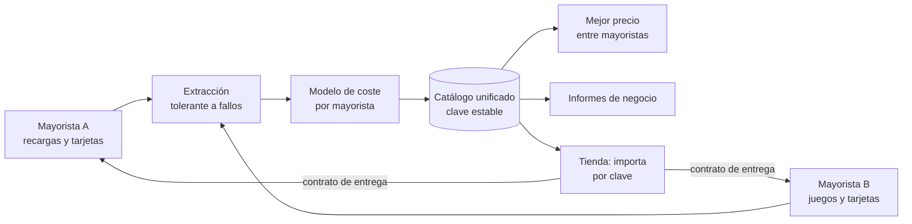

# Motor de catálogo y precios de recargas

> Unifica los catálogos de varios mayoristas de recargas, tarjetas de regalo y
> juegos en un solo formato. Calcula el coste real de cada producto y el precio
> al que conviene venderlo, y deja escrito cómo pedir la entrega de cada uno.

**Estado:** en uso: es la herramienta con la que se mapean los mayoristas y se
fija el modelo de precios de [recargasdigitales.com](https://recargasdigitales.com) ·
**Sistema propietario** de Kusarive Solutions LLC ·
[English version](README.en.md) ·
[Página de presentación](https://rjblancos.github.io/api-juegos-recargas-showcase/) ·
**[Descargar la presentación en PDF](presentacion/Motor-catalogo-recargas-presentacion.pdf)** (10 diapositivas)

---

## Qué resuelve

Cada mayorista habla su propio idioma. Uno cobra con descuento sobre el valor
de cara, otro con un precio directo, y otro añade comisiones fijas que se comen
el margen en las tarjetas pequeñas. Algunos emiten en otra moneda. Cada uno
pide datos distintos para entregar: un teléfono, un ID de jugador, un servidor.

Comparar eso a mano es imposible a escala de miles de productos. Por eso, vender
a valor de cara sin hacer la cuenta puede salir a pérdida sin que nadie lo
note.

Este motor lo resuelve antes de que el producto llegue a la tienda. Cada
producto sale con su coste real, su precio sugerido, si es rentable o no, qué
hay que pedirle al cliente y cómo se pide la entrega.

## Qué hace

- **Mapea el catálogo completo de cada mayorista** por su API: recargas de
  teléfono, tarjetas de regalo, recargas de juegos y pago de servicios.
- **Un solo formato para todos.** Cada producto, venga de donde venga, sale con
  las mismas columnas y una clave estable que nunca cambia entre mapeos.
- **Coste real por denominación.** Aplica el modelo de cada mayorista:
  descuento, comisión fija, comisión porcentual y moneda de emisión.
- **Precio de venta para el margen que se pida**, y marca los productos que no
  son rentables vendidos a valor de cara.
- **Elige el mayorista más barato** cuando dos venden el mismo producto.
- **Contrato de entrega por producto.** Cada fila dice qué datos pedir al
  cliente y qué enviar al mayorista para entregar.
- **Pedidos en modo simulación por defecto.** Ninguna prueba gasta saldo: para
  comprar de verdad hay que habilitarlo de forma explícita.
- **Informes de negocio generados.** Qué conviene vender por ganancia, análisis
  comparativo entre mayoristas y el catálogo de cada uno.
- **Imágenes incluidas.** Cada producto trae la imagen que da su mayorista: no
  se sube ninguna a mano.

## Beneficios

| | |
|---|---|
| **Nunca vender a pérdida** | Los productos que pierden a valor de cara salen marcados antes de publicarse. |
| **Añadir un mayorista no toca a los demás** | Cada uno vive en su propio módulo con la misma forma: configuración, cliente, extracción, precios e informe. |
| **Una tienda puede limitarse a importar** | Recibe un fichero con todo resuelto y crea sus productos por la clave estable. |
| **Historial de precios** | Cada mapeo queda fechado, así que se ve cómo cambian los costes. |
| **Corre en cualquier servidor** | Solo necesita el intérprete de Python: cero dependencias, cero instalación. |

## Arquitectura



Si un mayorista o una categoría fallan, el fallo se anota en un manifiesto y
aparece en el informe, y el resto del mapeo continúa.

## Ejemplo de una fila del catálogo unificado

Datos inventados. El formato es el real:
[`ejemplos/fila-unificada.json`](ejemplos/fila-unificada.json).

```json
{
  "sku": "mayorista-b:juego:ejemplo_juego:paquete_100",
  "linea": "juego",
  "variante": "100 monedas",
  "costo_usd": 0.95,
  "precio_venta_sugerido": 1.1875,
  "margen_pct": 20,
  "vendible": "si",
  "entrega": "recarga_directa",
  "campos_requeridos": "User ID|Server ID",
  "order_ref": {"kind": "juego", "category_id": "ejemplo_juego", "offer_id": "paquete_100"}
}
```

## Garantías técnicas

| Área | Qué garantiza el sistema |
|---|---|
| **Precios** | Un mismo cálculo de margen para todos los mayoristas: `precio = coste / (1 − margen)`. Lo que cambia es de dónde sale el coste. |
| **Dinero** | Los pedidos simulan por defecto; comprar de verdad exige una orden explícita. Las credenciales de producción nunca se versionan. |
| **Resiliencia** | Extracción tolerante a fallos: un endpoint caído no detiene el mapeo y queda registrado. |
| **Calidad** | 24 verificaciones automáticas del modelo de costes y del pipeline, sin red, antes de cada cambio. |

## Construido con

| Lenguaje | Dónde | Tamaño aproximado |
|---|---|---|
| **Python** | Clientes de cada mayorista, modelo de costes, unificación, informes y pruebas. Solo biblioteca estándar | 2.600 líneas |
| **Shell** | Ejecución de una pasada completa | 80 líneas |

La barra de lenguajes de GitHub mide solo los ficheros de este repositorio, que
es documentación.

## Resultados

Cifras reales del último mapeo:

- **13.346 productos** unificados de dos mayoristas, **12.119 de ellos
  vendibles** (con stock y coste).
- **158 países** y **600 operadores** de recargas de teléfono.
- **314 juegos** y **579 marcas** de tarjetas de regalo.
- Sobre este mapeo se construyó el catálogo de **2.600 recargas y tarjetas** que
  vende [recargasdigitales.com](https://recargasdigitales.com).

## Contacto

Rafael Blanco, para Kusarive Solutions LLC

- Web: [recargasdigitales.com](https://recargasdigitales.com)
- Correo: info@recargasdigitales.com
- WhatsApp: [+58 412 896 2261](https://wa.me/584128962261)
- Presentación: [PDF de 10 diapositivas](presentacion/Motor-catalogo-recargas-presentacion.pdf)

## Novedades

- **27-oct-2026** · Publicación de la vitrina, con su presentación en PDF descargable.

Registro completo: [CHANGELOG.md](CHANGELOG.md).

© 2026 Kusarive Solutions LLC. Ver [LICENSE](LICENSE).
